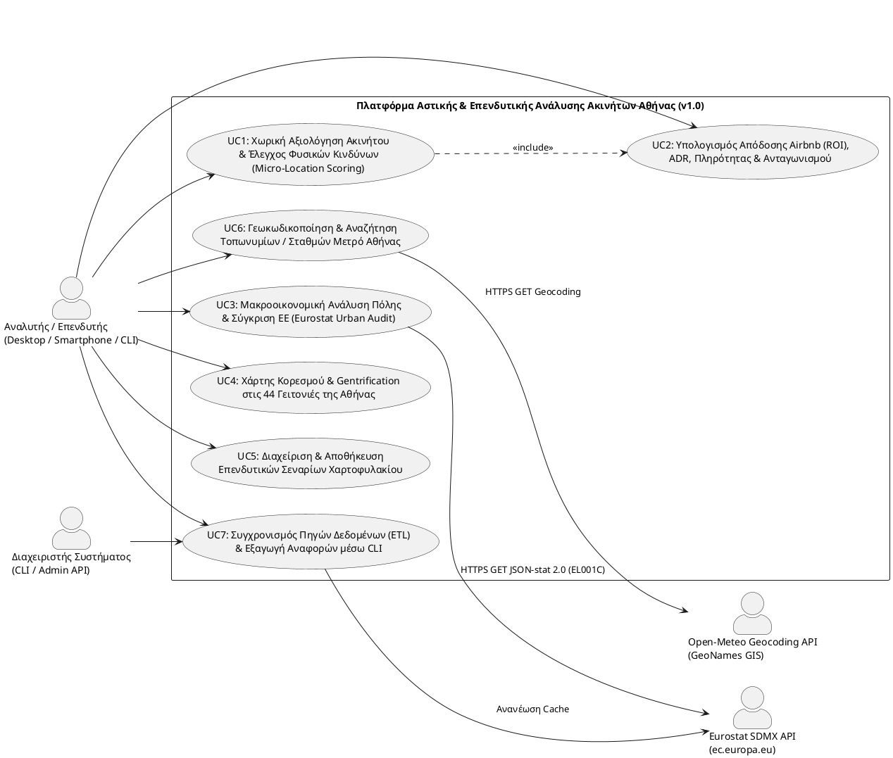

# Έγγραφο Προδιαγραφών Απαιτήσεων Λογισμικού (SRS) — Έκδοση 1.0

**Μάθημα:** Τεχνολογία Λογισμικού (ΕΜΠ - Σχολή ΗΜΜΥ, Χειμερινό Εξάμηνο 2026–2027)  
**Διδάσκων:** Καθ. Β. Βεσκούκης  
**Τίτλος Έργου:** Πλατφόρμα Αστικής & Επενδυτικής Ανάλυσης Ακινήτων (Athens Real Estate & Urban Analytics Platform)  
**Κωδικός Ομάδας:** `softeng26-XX`  
**Έκδοση:** `v1.0 (Full Layered & MVC Implementation with Live APIs)`

---

## 1. Εισαγωγή & Σκοπός του Συστήματος

### 1.1 Αντικείμενο & Όραμα Εφαρμογής
Η **Πλατφόρμα Αστικής & Επενδυτικής Ανάλυσης Ακινήτων** αποτελεί ένα ολοκληρωμένο σύστημα υποστήριξης αποφάσεων (Spatial Decision Support System) για επενδυτές ακινήτων, μηχανικούς, αναλυτές αστικής ανάπτυξης και διαχειριστές βραχυχρόνιων μισθώσεων στον **Δήμο Αθηναίων (`EL300` / `EL001C`)**.

Η εφαρμογή επιτρέπει στον αναλυτή να επιλέξει οποιοδήποτε γεωγραφικό σημείο στον χάρτη της Αθήνας (ή να αναζητήσει τοπωνύμιο/σταθμό Μετρό) και να λάβει σε πραγματικό χρόνο:
1. **Σύνθετη Επενδυτική Βαθμολογία (`Investment Score 0–100` & Βαθμίδα `A+` έως `C`)** βασισμένη σε 5 σταθμισμένους παράγοντες.
2. **Οικονομική Αποτίμηση Βραχυχρόνιας Μίσθωσης (Airbnb ROI):** Μέση Ημερήσια Τιμή ($ADR$), Μέση Ετήσια Πληρότητα ($Occupancy\ Rate$), Ετήσιο Ακαθάριστο/Καθαρό Έσοδο, Gross/Net ROI (%), Έτη Απόσβεσης και ποσοστιαία υπεραπόδοση έναντι της μακροχρόνιας μίσθωσης.
3. **Χωρική Ανάλυση Υποδομών & Φυσικών Κινδύνων (Athens GIS):** Ακριβή απόσταση Haversine και χρόνο πεζοπορίας από τους 16 κεντρικούς σταθμούς Μετρό/ΗΣΑΠ και τα ΑΕΙ/Σχολεία της Αθήνας, καθώς και αυτόματο έλεγχο *Point-in-Polygon* για **Ζώνες Πλημμυρικού Κινδύνου** (π.χ. Κοίτη Ιλισού, Ρέμα Κυψέλης) και **Αστικής Θερμικής Νησίδας**.
4. **Χάρτη Κορεσμού & Gentrification (44 Επίσημες Γειτονιές Αθήνας):** Απεικόνιση Choropleth Heatmap βάσει των **14.171 ενεργών καταλυμάτων Inside Airbnb** της Αθήνας ανά $1.000$ κατοίκους.
5. **Μακροοικονομικό Πίνακα Ελέγχου Eurostat Urban Audit (`urb_*`):** Χρονοσειρές τουρισμού, δημογραφίας, κατοικιών και συγκριτικό ευρωπαϊκό benchmark μεσογειακών μητροπόλεων (Αθήνα, Βαρκελώνη, Λισαβόνα, Ρώμη).

---

## 2. Πηγές Δεδομένων & Προγραμματιστικές Διεπαφές (Χωρίς Απαίτηση API Key)

Και οι τρεις (3) επιλεγμένες πηγές δεδομένων είναι **ανοιχτής πρόσβασης και δεν απαιτούν ιδιωτικά κλειδιά (API Keys)**:

| # | Κατηγορία (Παράρτημα) | Πηγή Δεδομένων | Τρόπος Πρόσβασης & Μορφότυπος | Πραγματικά Δεδομένα Έκδοσης v1.0 |
|---|---|---|---|---|
| **1** | **Κατηγορία 9:** Τουρισμός & Βραχυχρόνιες Μισθώσεις | **Inside Airbnb** (`data.insideairbnb.com`) | Αρχεία `GeoJSON` & `CSV` (`neighbourhoods.geojson`, `listings.csv`), CC BY 4.0 | **44 επίσημα πολύγωνα γειτονιών Αθήνας** & στατιστική επεξεργασία **14.171 ενεργών καταλυμάτων Αθήνας** (με στρωματοποιημένο δείγμα 345 πραγματικών καταλυμάτων στον χάρτη). |
| **2** | **Κατηγορία 7:** Γεωχωρικά Δεδομένα (GIS) | **Athens GIS Repository** (`athensgis.gr`) & **Open-Meteo Geocoding API** | Γεωχωρικά επίπεδα `GeoJSON` & REST Geocoding API (`geocoding-api.open-meteo.com/v1/search`) | **28 Σημεία Υποδομών GIS** (16 Σταθμοί Μετρό/ΗΣΑΠ, 8 ΑΕΙ/Σχολεία, 4 Πολιτιστικά/Τραπεζικά κέντρα) & **3 Πολύγωνα Φυσικών Κινδύνων** (Πλημμύρα Ιλισού, Ρέμα Κυψέλης, Θερμική Νησίδα Ομόνοιας). |
| **3** | **Κατηγορία 6:** Στατιστικά Δεδομένα | **Eurostat - City Statistics / Urban Audit** (`ec.europa.eu/eurostat`) | Ζωντανό **REST API (`JSON-stat 2.0` / `SDMX 3.0`)** χωρίς εγγραφή/κλειδί | Σύνολα `urb_cpop1` (`DE1001V`), `urb_ctour` (`CR2001V`), `urb_clivcon` (`SA1001V`) για τον επίσημο κωδικό Αθήνας **`EL001C`** (`Athina - Greater City`) και ευρωπαϊκό benchmark. |

---

## 3. Διάγραμμα Περιπτώσεων Χρήσης (UML Use Case Diagram - 7 Use Cases)

---

## 4. Αναλυτική Προδιαγραφή των 7 Περιπτώσεων Χρήσης (Use Cases)

### UC1: Χωρική Αξιολόγηση Ακινήτου & Έλεγχος Φυσικών Κινδύνων (Micro-Location Scoring)
* **Actor:** Αναλυτής / Επενδυτής
* **Προϋποθέσεις:** Έχουν φορτωθεί στη μνήμη τα γεωχωρικά επίπεδα των 44 γειτονιών, των 28 σημείων ενδιαφέροντος και των 3 ζωνών φυσικών κινδύνων.
* **Κύρια Ροή:**
  1. Ο αναλυτής επιλέγει σημείο $(\phi, \lambda)$ στον χάρτη ή εισάγει συντεταγμένες, ακτίνα $R \in [350, 1000]\text{ m}$ και δωμάτια $N \in \{1, 2, 3\}$.
  2. Το σύστημα εκτελεί τον αλγόριθμο **Ray-Casting (`point_in_polygon`)** στα 44 πολύγωνα της Αθήνας και αναγνωρίζει τη γειτονιά και τους πολεοδομικούς της δείκτες (Συντελεστής Δόμησης, μέση τιμή αγοράς $€/\text{m}^2$).
  3. Το σύστημα υπολογίζει την απόσταση μεγίστου κύκλου (**Haversine**) από τους 16 σταθμούς Μετρό/ΗΣΑΠ και τα Πανεπιστήμια/Σχολεία:
     $$d = 2 r \arcsin\left(\sqrt{\sin^2\left(\frac{\Delta\phi}{2}\right) + \cos(\phi_1)\cos(\phi_2)\sin^2\left(\frac{\Delta\lambda}{2}\right)}\right)$$
  4. Το σύστημα ελέγχει αν το σημείο βρίσκεται εντός πολυγώνου φυσικού κινδύνου (Πλημμύρα Κοίτης Ιλισού: $-22\text{ pts}$, Ρέμα Κυψέλης: $-14\text{ pts}$, Θερμική Νησίδα Ομόνοιας: $-10\text{ pts}$).
  5. Το σύστημα συνθέτει το τελικό **Investment Score (0–100)**.

### UC2: Υπολογισμός Απόδοσης Airbnb (ROI), ADR, Πληρότητας & Ανταγωνισμού
* **Actor:** Αναλυτής / Επενδυτής
* **Κύρια Ροή:**
  1. Το σύστημα εντοπίζει τα ανταγωνιστικά καταλύματα Inside Airbnb σε απόσταση $d \le R$ και σταθμίζει την τοπική τιμή με τον πραγματικό μέσο όρο της γειτονιάς (από τα 14.171 καταλύματα της Αθήνας).
  2. Υπολογίζει το εκτιμώμενο $ADR$, την πληρότητα ($Occupancy\ Rate$), τις κατειλημμένες νύχτες ανά έτος ($N_{occ} = 365 \times Occ$), το Ετήσιο Ακαθάριστο Έσοδο ($Gross = ADR \times N_{occ}$) και το Καθαρό Έσοδο ($Net = 0.72 \times Gross$).
  3. Υπολογίζει το $Gross\ ROI = \frac{Gross}{Cost_{acq}} \times 100\%$, τα έτη απόσβεσης ($Payback = \frac{Cost_{acq}}{Net}$) και τη διαφορά απόδοσης έναντι της μακροχρόνιας μίσθωσης.

### UC3: Μακροοικονομική Ανάλυση Πόλης & Σύγκριση ΕΕ (Eurostat Urban Audit)
* **Actor:** Αναλυτής / Επενδυτής
* **Κύρια Ροή:** Το σύστημα ανακτά μέσω του `GET /api/v1/macro/urban-audit?city=EL300` τις χρονοσειρές της Eurostat (`urb_cpop1`, `urb_ctour`, `urb_clivcon`) για τον επίσημο κωδικό `EL001C` (Αθήνα) και προβάλλει γραφήματα εξέλιξης τουριστικών διανυκτερεύσεων, δείκτη τιμών κατοικιών και συγκριτικό γράφημα με Βαρκελώνη, Λισαβόνα και Ρώμη.

### UC4: Χάρτης Κορεσμού & Gentrification στις 44 Γειτονιές της Αθήνας
* **Actor:** Αναλυτής / Επενδυτής
* **Κύρια Ροή:** Το σύστημα υπολογίζει για καθεμία από τις 44 επίσημες γειτονιές της Αθήνας τον δείκτη τουριστικού κορεσμού ανά $1.000$ κατοίκους και χρωματίζει τα πολύγωνα στον χάρτη (`#22c55e` Χαμηλός, `#eab308` Μέτριος, `#f97316` Υψηλός, `#ef4444` Υπερκορεσμός).

### UC5: Διαχείριση & Αποθήκευση Επενδυτικών Σεναρίων Χαρτοφυλακίου
* **Actor:** Αναλυτής / Επενδυτής
* **Κύρια Ροή:** Ο αναλυτής αποθηκεύει την τρέχουσα αξιολόγηση με προσαρμοσμένο τίτλο (`POST /api/v1/scenarios`) και μπορεί να ανακαλέσει οποιοδήποτε αποθηκευμένο σενάριο (`GET /api/v1/scenarios`) με 1 κλικ στον χάρτη.

### UC6: Γεωκωδικοποίηση & Αναζήτηση Τοπωνυμίων / Σταθμών Μετρό Αθήνας
* **Actor:** Αναλυτής / Επενδυτής
* **Κύρια Ροή:** Ο αναλυτής πληκτρολογεί όνομα γειτονιάς, σταθμού Μετρό ή περιοχής της Αττικής (`GET /api/v1/gis/geocode?q=...`). Το σύστημα αναζητά στις 44 γειτονιές, στα 28 POIs του Athens GIS και στο Open-Meteo Geocoding API και μετακινεί τον χάρτη στο επιλεγμένο σημείο.

### UC7: Συγχρονισμός Πηγών Δεδομένων (ETL) & Εξαγωγή Αναφορών μέσω CLI
* **Actor:** Διαχειριστής Συστήματος / Αναλυτής
* **Κύρια Ροή:** Εκτέλεση του CLI (`urban_cli.py` ή `urban_mvc_cli.py`) για συγχρονισμό των πηγών (`POST /api/v1/admin/sync`) και εκτύπωση δομημένων πινάκων αξιολόγησης στο τερματικό.

---

## 5. Μη Λειτουργικές Απαιτήσεις (Non-Functional Requirements)

1. **Απόδοση (Performance):** Ο χρόνος απόκρισης (p95 latency) του χωρικού αλγορίθμου αξιολόγησης (`/api/v1/properties/evaluate`) πρέπει να είναι $< 50\text{ ms}$ (στην πράξη μετρήθηκε $< 3\text{ ms}$).
2. **Διαθεσιμότητα & Ανθεκτικότητα (Resilience):** Σε περίπτωση μη διαθεσιμότητας των εξωτερικών APIs (Eurostat SDMX ή Open-Meteo), το σύστημα μεταπίπτει αδιαφανώς (graceful fallback) στην τοπική επαληθευμένη cache χωρίς διακοπή λειτουργίας.
3. **Αρχιτεκτονική Συμμόρφωση:** Πλήρης υλοποίηση τόσο σε **Layered Architecture (`layered/`)** με Responsive UI όσο και σε **MVC Architecture (`mvc/`)** με δύο διακριτά Views (`/desktop` και `/mobile`).

---

## 6. Αναφορά Διαγραμμάτων UML ως Κώδικα (`documentation/diagram-as-code/`)

Όλα τα απαιτούμενα διαγράμματα UML έχουν παραχθεί σε μορφή κώδικα PlantUML (`.puml`):

* **Layered Architecture (`documentation/diagram-as-code/layered/`):**
  * `softeng26-XX-data-design.puml` (Data Design Diagram)
  * `softeng26-XX-activity.puml` (UML Activity Diagram)
  * `softeng26-XX-state.puml` (UML State Diagram)
  * `softeng26-XX-class.puml` (UML Class Diagram)
  * `softeng26-XX-api.puml` (UML API Sequence Diagram)
  * `softeng26-XX-component.puml` (UML Component Diagram)
  * `softeng26-XX-deployment.puml` (UML Deployment Diagram)
* **MVC Architecture (`documentation/diagram-as-code/mvc/`):**
  * `softeng26-XX-data-design.puml`
  * `softeng26-XX-activity.puml`
  * `softeng26-XX-state.puml`
  * `softeng26-XX-class.puml`
  * `softeng26-XX-api.puml`
  * `softeng26-XX-component.puml`
  * `softeng26-XX-deployment.puml`
